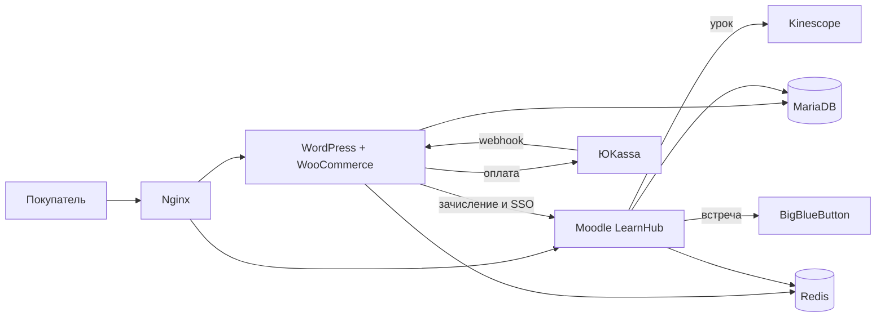

# АЦО — онлайн-школа цифровых профессий

Живой продукт: витрина курсов, оплата, личные кабинеты и онлайн-встречи. Покупатель оплачивает курс на сайте, учится в Moodle, созванивается с преподавателем из кабинета.

| | |
| --- | --- |
| Сайт | [www.acoedu.ru](https://www.acoedu.ru) |
| Учебная платформа | [learn.acoedu.ru](https://learn.acoedu.ru) |
| Компания | ООО «Академия цифрового образования» |

Репозиторий — **свой слой продукта**, не копия ядер WordPress и Moodle. Ядра ставятся официальными дистрибутивами, поверх кладётся этот код. Секреты (база, SMTP, ЮKassa, ключ комнаты) живут только на сервере.

---

## Стек

| Слой | Технология |
| --- | --- |
| Витрина и кабинеты сайта | WordPress, PHP 8.2-FPM, тема `aco-theme` |
| Магазин | WooCommerce, цифровой товар без доставки |
| Оплата | ЮKassa: карта и СБП, переход на страницу ЮKassa, webhook возврата |
| Учебная платформа | Moodle 4.5, PHP 8.1, тема LearnHub, формат курса `aco` |
| Видео уроков | Kinescope, embed в плеере курса |
| Онлайн-встречи | BigBlueButton, активность `bigbluebuttonbn`, комнаты из кабинета |
| Связка магазина и учёбы | Edwiser Bridge: зачисление и SSO (AES-256-ECB) |
| Почта | Unisender Go по SMTP; локально Mailpit |
| Вход по телефону | Российский мобильный `+79…`, код в SMS. Шлюз подключается фильтром, пока ключа нет — заглушка |
| База | MariaDB 10.11, отдельные базы WordPress и Moodle |
| Кэш | Redis 7 |
| Прокси и TLS | Nginx, Let's Encrypt |
| Контейнеры | Docker Compose: локальный `docker-compose.yml` и боевой `docker-compose.prod.yml` |
| Фронт кабинета | Свой SCSS/CSS, без отдельного SPA. Сетки 1280 / 768 / 401 |

Кроны: `wp-cron` и `moodle-cron` в своих контейнерах. WP-CLI стоит в образе WordPress.

---

## Как это связано



- **www.acoedu.ru** — каталог, карточка курса, блог, оферта, контакты, кабинет ученика и панель школы.
- **learn.acoedu.ru** — программа курса, плеер, домашки, куратор и встречи.
- После оплаты заказ в WooCommerce становится оплаченным, ученик получает доступ в Moodle.

---

## Сайт

Тема `wordpress/wp-content/themes/aco-theme`.

- Главная, каталог, карточка курса, блог, «О школе», помощь, партнёры, контакты.
- Юридические страницы: оферта, политика, персональные данные, возврат, cookies.
- Чекаут WooCommerce под цифровой курс: `woocommerce/checkout`. Карта на сайте не вводится.
- Кабинет ученика (`page-account.php`) и панель администратора школы (`page-aco-admin.php`).
- Письма: коды, заявки, партнёры — `inc/mail.php`.
- Зачисление, прогресс и SSO — `inc/moodle-*.php`.
- Телефон как второй способ входа — `inc/phone-auth.php`. Провайдер SMS выбирается константой `SMS_PROVIDER` или фильтром `aco_send_sms`, регистрацию для этого менять не нужно.

Точечные правки ядра вынесены в `wordpress/wp-content/mu-plugins` (возврат с ЮKassa, локальный allowlist Edwiser).

---

## Учёба в Moodle

Тема `moodle/theme/learnhub`, формат программы `moodle/course/format/aco`.

- Конструктор курса: модули, урок, тест, домашка, видео Kinescope.
- Плеер ученика: цепочка уроков, прогресс, переход дальше после выполнения.
- Кабинет преподавателя: панель курса, студенты, домашки, куратор.
- Имена из почтовых ящиков Edwiser приводятся к короткому имени, почта остаётся второй строкой.
- Кабинет собран под телефон и планшет: меню переносится, карточки и кнопки не обрезаются.

Сертификат об окончании курса с платформы снят. Старый адрес `certificate.php` ведёт на страницу курса, а не на бланк.

### Студенты и домашки

Вкладка «Студенты» — карточки: прогресс, работы на проверке и на доработке. «Проверить» открывает сдачу, «Написать» — диалог куратора. Кнопка «Домашки» стоит в строке заголовка.

Проверка работы: решение под текстом задания, «Принять» и «На доработку» на узком экране на всю ширину.

### Куратор

Переписка ученика и преподавателя в одном треде: лента сообщений, вложения, поле ввода, которое остаётся над клавиатурой телефона. Тред создаётся с первым сообщением.

---

## Онлайн-встречи

Встреча — это активность BigBlueButton, а не отдельный видеосервис внутри WordPress.

Преподаватель в кабинете нажимает «Создать онлайн-встречу»: курс, название, начало, длительность, текст и список студентов. Приглашённые видят встречу во вкладке «Онлайн-встречи» и могут получить письмо. Гостевой ссылки нет: в комнату попадают только из своего аккаунта. Комната ждёт преподавателя. Учитель и ученики входят в одну комнату через группу Moodle (`SEPARATEGROUPS`), поэтому ссылку нельзя переслать постороннему.

Отдельный контур — планёрка администратора с преподавателями. Она лежит в скрытом служебном курсе, в программу ученика не попадает.

Выход из комнаты возвращает человека в кабинет: небольшой редирект в `moodle/mod/bigbluebuttonbn/bbb_view.php` на `theme/learnhub/room_back.php`.

Код кабинета:

| Что | Где |
| --- | --- |
| Создание и список встреч преподавателя | `theme/learnhub/teacher/meeting.php`, `meetings.php` |
| Список ученика | `theme/learnhub/meetings.php` |
| Планёрка с преподавателями | `theme/learnhub/staff/` |
| Правила комнат, группы, письма | `theme/learnhub/classes/meetings.php` |
| Возврат из комнаты | `room_back.php` |

Урок в программе курса и живая встреча кабинета — разные вещи. Урок-видео смотрится через Kinescope внутри плеера. Встреча не встаёт в цепочку уроков: она в нулевом разделе курса и видна только приглашённым.

Адрес сервера BigBlueButton и общий секрет задаются в настройках Moodle на сервере. В git их нет.

Форма встречи на узкой ширине складывается в одну колонку: поля, длительность и имена приглашённых не обрезаются.

---

## Что лежит в репозитории

```
wordpress/wp-content/themes/aco-theme   витрина, кабинеты, чекаут, почта, SSO
wordpress/wp-content/mu-plugins         точечные правки
moodle/theme/learnhub                   плеер, преподаватель, встречи, куратор
moodle/course/format/aco                формат программы курса
moodle/mod/bigbluebuttonbn/bbb_view.php возврат из комнаты в кабинет
docker-compose.yml                      локальный стек и Mailpit
docker-compose.prod.yml                 боевой стек
nginx/                                  прокси и выпуск TLS
deploy/                                 бэкап и выкладка на сервер
.env.example                            имена переменных без боевых секретов
```

**Сюда не входят:** ядра WordPress и Moodle, плагины из каталога, загрузки учеников, `moodledata`, `.env`, `wp-config.php`, `moodle/config.php`, ключи ЮKassa и BigBlueButton.

---

## Как запустить локально

Нужны Docker и записи в `/etc/hosts`:

```
127.0.0.1 wp.localtest.me moodle.localtest.me
```

Ядра WordPress и Moodle кладутся в `wordpress/` и `moodle/`, затем этот репозиторий накладывается поверх.

```bash
cp .env.example .env
cp moodle/config-dist.php moodle/config.php
docker compose up -d --build
```

- Сайт: http://wp.localtest.me
- Moodle: http://moodle.localtest.me:8081
- Письма: http://localhost:8025

Боевой запуск: `docker compose -f docker-compose.prod.yml up -d --build`. Чеклист сервера — в [HOSTING.md](HOSTING.md). Почта — в [docs/pochta-i-zayavki.md](docs/pochta-i-zayavki.md). Оплата — в [docs/yookassa-precheck.md](docs/yookassa-precheck.md).

---

## Куда смотреть в коде

| Задача | Файл |
| --- | --- |
| Главная и шапка | `aco-theme/front-page.php`, `header.php` |
| Оплата и возврат с ЮKassa | `woocommerce/checkout/`, `mu-plugins/aco-yookassa-return.php` |
| Зачисление после покупки | `aco-theme/inc/moodle-enrollment.php` |
| Вход на учёбу без второго пароля | `aco-theme/inc/moodle-sso.php` |
| Плеер урока | `learnhub/classes/course_player.php` |
| Конструктор программы | `learnhub/builder/` |
| Проверка домашки | `learnhub/teacher/homework.php` |
| Чат куратора | `learnhub/classes/curator.php` |
| Встречи | `learnhub/classes/meetings.php` |

Лицензия: GPL-3.0-or-later.
