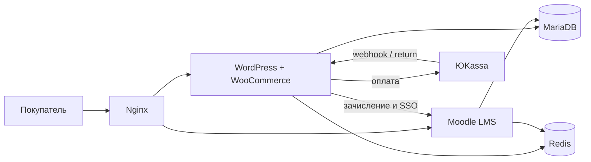

# АЦО — онлайн-школа цифровых профессий

<p align="center">
  
</p>

**WordPress + WooCommerce + Moodle** в Docker: витрина курсов, оплата, личный кабинет и учебный плеер.

| | |
|---|---|
| Сайт | [www.acoedu.ru](https://www.acoedu.ru) |
| Учебная платформа | [learn.acoedu.ru](https://learn.acoedu.ru) |
| Стек | PHP 8.2 / 8.1, MariaDB, Redis, Nginx, Docker |
| Платежи | ЮKassa (карта / СБП, цифровая услуга) |

Репозиторий — **свой слой продукта**, не копия ядер WordPress и Moodle. Ядра ставятся официальными дистрибутивами, поверх кладётся этот код.

---

## Что это за продукт

АЦО продаёт онлайн-курсы (Python, Frontend, Backend, UX/UI, аналитика). Покупатель оплачивает курс на сайте, доступ открывается в кабинете и в Moodle. Физической доставки нет.

Для рекрутера, коротко:

- это не лендинг на конструкторе, а связка **магазина и LMS**;
- ученик и преподаватель работают в разных кабинетах;
- оплата уходит на защищённую страницу ЮKassa, карта на нашем сайте не вводится;
- на сайте есть оферта, реквизиты компании и страница «как получить курс».

---

## Что сделано в этом коде

| Блок | Где смотреть |
|---|---|
| Витрина, каталог, карточка курса, блог, оферта, контакты | `wordpress/wp-content/themes/aco-theme` |
| Чекаут WooCommerce под цифровой курс | `aco-theme/woocommerce/checkout` |
| Кабинет ученика и панель администратора | `page-account.php`, `page-aco-admin.php` |
| Почта (коды входа, заявки) | `aco-theme/inc/mail.php` |
| Связка WP ↔ Moodle (зачисление, SSO) | `inc/moodle-*.php`, `mu-plugins/` |
| Плеер курса, кабинет преподавателя | `moodle/theme/learnhub` |
| Формат курса АЦО (модули, прогресс, сертификат) | `moodle/course/format/aco` |
| Боевой Docker / Nginx / TLS | `docker-compose.prod.yml`, `nginx/prod` |

---

## Архитектура



- **www.acoedu.ru** — витрина и кабинет на WordPress.
- **learn.acoedu.ru** — уроки на Moodle, тема LearnHub.
- После оплаты заказ в WooCommerce помечается оплаченным, ученик получает доступ в Moodle.

---

## Что лежит в репозитории

```
aco-theme/          тема сайта и кабинетов
mu-plugins/         точечные правки (возврат с ЮKassa)
theme/learnhub/     учебный интерфейс Moodle
course/format/aco   формат программы курса
docker-compose*.yml локальный и боевой стек
nginx/              прокси и выпуск TLS
.env.example        переменные без секретов
```

**Сюда не входят:** ядро WordPress/Moodle, плагины из каталога, загрузки учеников, `.env`, `wp-config.php`, `moodle/config.php`.

---

## Как запустить локально

Нужны Docker и записи в `/etc/hosts`:

```
127.0.0.1 wp.localtest.me moodle.localtest.me
```

Ядра WP и Moodle положите в `wordpress/` и `moodle/`, затем наложите этот репозиторий поверх.

```bash
cp .env.example .env
cp moodle/config-dist.php moodle/config.php
docker compose up -d --build
```

- Сайт: http://wp.localtest.me
- Moodle: http://moodle.localtest.me:8081
- Письма: http://localhost:8025 (Mailpit)

Боевой запуск: `docker compose -f docker-compose.prod.yml up -d --build`. Чеклист сервера — в `HOSTING.md`.

Секреты (БД, SMTP, ключ ЮKassa) только в `.env` на сервере, не в git.

---

## Стек

- WordPress 6 + WooCommerce + тема **aco-theme**
- Moodle 4 + тема **learnhub** + формат **aco**
- Edwiser Bridge (SSO и зачисление)
- ЮKassa для WooCommerce
- Nginx, MariaDB 10.11, Redis 7, Docker Compose

---

GPL-3.0-or-later. Боевой сайт: [acoedu.ru](https://www.acoedu.ru).
